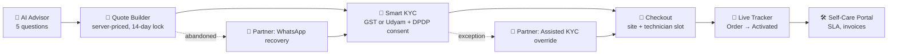
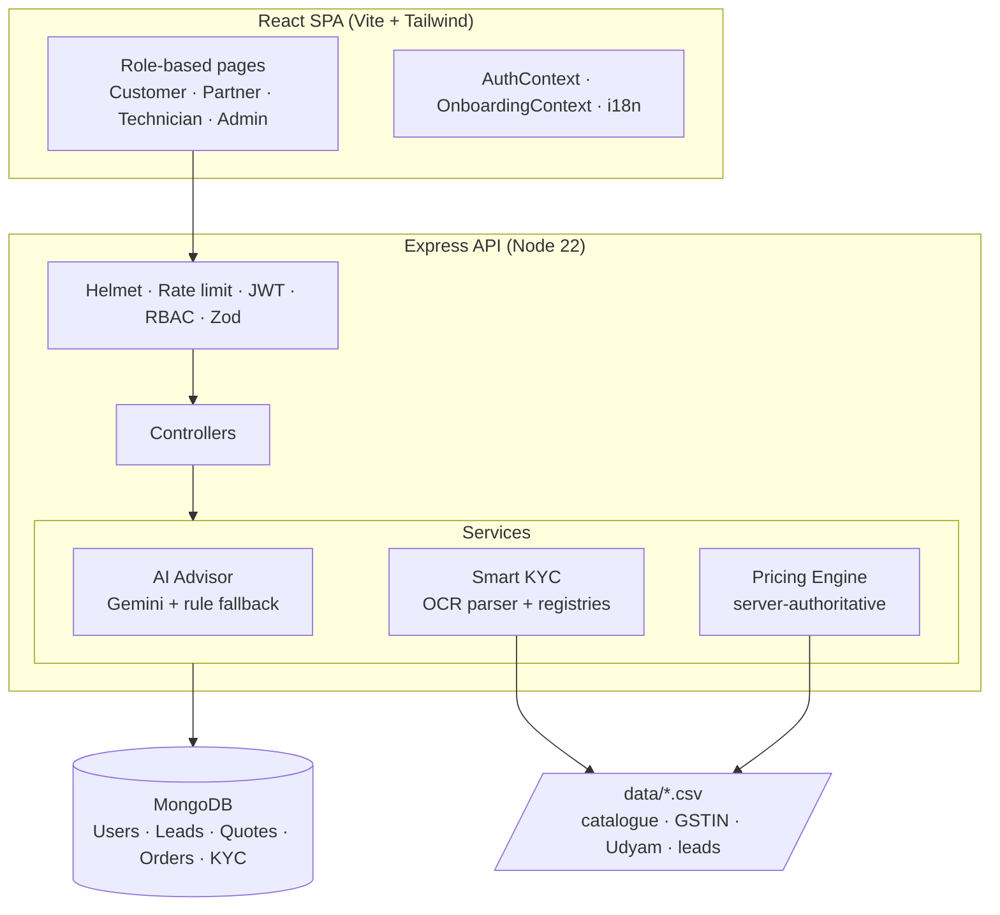

<div align="center">

# 🇮🇳 Project Udyam Digital

### Take a small business from "I need a connection" to "I'm live", in one sitting.

**Airtel SYNC Hackathon 2026 · Enterprise Track A**
Fictional operator context: **Accel Telecom / Accel Business**


[Live Demo](#-live-demo) · [Demo Video](#-live-demo) · [Quick Start](#-quick-start) · [Business Impact](#-business-impact) · [Docs](#-documentation)

</div>

> [!NOTE]
> **Case-study disclaimer.** This is a hackathon prototype built for the Airtel SYNC Enterprise Track A case study. It uses the SYNC enterprise visual language with the fictional operator *Accel Telecom*. It is **not** connected to live Airtel network systems or real government (GST / Udyam) servers. KYC OCR, registry lookups and payments are **simulated** against the provided mock datasets.

---

## 📌 Table of Contents

1. [The Problem](#-the-problem)
2. [Our Solution](#-our-solution)
3. [Live Demo](#-live-demo)
4. [How It Works](#-how-it-works)
5. [Features by Role](#-features-by-role)
6. [Language Support](#-10-language-support)
7. [Architecture](#-architecture)
8. [AI Advisor Design](#-ai-advisor-design)
9. [Security & DPDP Compliance](#-security--dpdp-compliance)
10. [Datasets](#-datasets-used)
11. [Tech Stack](#-tech-stack)
12. [Quick Start](#-quick-start)
13. [Demo Accounts](#-demo-accounts)
14. [Testing](#-testing)
15. [Business Impact](#-business-impact)
16. [Scope, Limitations & Roadmap](#-scope-limitations--roadmap)
17. [Repository Structure](#-repository-structure)
18. [Documentation](#-documentation)
19. [Team](#-team)

---

## 🎯 The Problem

India has **63M+ MSMEs** contributing over **30% of GDP**, yet enterprise telecom sales to them is slow, manual and expensive. In the case-study cohort of **5,000 quarterly leads**:

| Pain point | Baseline |
| :--- | :--- |
| Lead → activation time | **17.6 days** |
| Quotation turnaround (field rep) | **3–5 days** |
| Lead → activation conversion | **7.36%** (368 of 5,000) |
| Blended CAC per activated business | **₹15,000** |
| Follow-up calls per customer | **3+** |
| Activation with GSTIN vs. without | **9.6% vs. 2.0%** |

**Root causes from the data:** paperwork delays (**39.3%** of drop-offs) and quote delays (**30.4%**), plus a structural bias against businesses that don't have a GSTIN.

---

## 💡 Our Solution

**Project Udyam Digital** is a digital-first, mobile-friendly sales and onboarding platform that replaces the paper-and-visits pipeline with one continuous flow:

> **Advise → Quote → Verify (KYC) → Schedule → Track → Self-serve**

Three ideas drive the design:

1. **Self-service first, human-assisted when needed.** Customers complete everything on a phone. Channel partners step in only for exceptions (blurry scans, name mismatches, abandoned quotes).
2. **The Udyam Bridge.** Businesses without a GSTIN can verify with an **Udyam** certificate, closing the biggest conversion gap in the dataset.
3. **Native-language, plain-English justification.** Ten Indian languages and AI recommendations that explain *why* a bundle fits a bakery or a kirana store, not just what it costs.

---

## 🎬 Live Demo

| Resource | Link |
| :--- | :--- |
| 🌐 Hosted app | `<add deployed URL>` |
| 🎥 3-minute demo video | `<add video URL>` |
| 📊 Pitch deck | `<add deck URL>` |
| 📜 Live-demo script | [`docs/DEMO_SCRIPT.md`](docs/DEMO_SCRIPT.md) |

<!-- Add screenshots/GIFs here -->
<!--
| Advisor | Quote Builder | Smart KYC |
|  |  |  |
| Order Tracker | Partner Queue | Executive Dashboard |
|  |  |  |
-->

---

## 🔄 How It Works



**Target journey time: under 1 sitting for the customer, ~1.5 days to activation** (vs. 17.6 days today).

---

## 👥 Features by Role

### 1️⃣ MSME Customer: *Sneha Rao (Saffron Bakers, Ludhiana) · Rajesh Gupta (Gupta Supermart)*

| Step | Route | What happens |
| :--- | :--- | :--- |
| **AI Business Advisor** | `/advisor` | Five conversational questions (business type, staff size, payments, WhatsApp usage, budget) in the customer's language. Returns a tailored bundle from the 25-product catalogue (`P01–P25`) with a plain-language reason. |
| **Quote Builder** | `/quote` | Customise items; choose 12/24/36-month terms (5% / 10% discounts); add static IP (`P11`) or cloud backup (`P17`). **Server-authoritative pricing** computes base MRC, discounts, setup fees and 18% GST. Quote is locked for **14 days**. |
| **Smart KYC** | `/kyc` | Explicit **DPDP Act 2023** consent, then GST or Udyam certificate upload. Simulated OCR extracts entity details and validates against the mock registries in **< 10 s**. |
| **Checkout & Scheduling** | `/checkout` | Confirm site address, pick a technician slot, preview the assigned technician, submit (simulated) payment. |
| **Live Order Tracker** | `/orders/:id` | Milestones: Order Placed → KYC Verified → Technician Assigned → Installation In Progress → **Activated & Live**. On activation: circuit ID, static IP and SLA monitor. **No status-chasing calls.** |
| **Self-Care Portal** | `/dashboard` | Bandwidth/SLA monitor, active line cards, downloadable monthly B2B GST invoice. |

### 2️⃣ Channel Partner: *Amit Verma (Delhi NCR)*

| Capability | Route / API | Detail |
| :--- | :--- | :--- |
| **Territory lead queue** | `/partner` | Filter by business name, city tier or drop-off stage. |
| **KYC Exceptions card** | `/partner` | Surfaces leads stuck on blurry scans or small trade-name mismatches. |
| **Abandoned Quotes card** | `/partner` | Surfaces leads that quoted but never checked out. |
| **Assisted KYC override** | `POST /api/partner/leads/:id/assist-kyc` | Partner verifies original documents on-site and submits a justification note, which unblocks the lead and advances the order. |
| **1-click recovery** | `/partner` | WhatsApp button opens a pre-filled chat with the customer's restored cart link. |

### 3️⃣ Smart KYC Partner & Field Technician

| Role | Landing | Purpose |
| :--- | :--- | :--- |
| **Smart KYC Partner** | `/partner` | Regional reviewers (e.g. `KYC-DEL-101`) who resolve document exceptions. |
| **Field Technician** | `/technician` | Receives installation tasks for their circle and moves the order through *Installation In Progress → Activated*. |

### 4️⃣ Executive Admin: *Priya Nair, Head of SME Growth & Digital Acquisition*

**Executive Analytics (`/admin`)**

- **KPI gauges:** conversion 7.36% (baseline), CAC ₹15,000 → ₹4,200 (target), activation 17.6 → 1.5 days (target).
- **6-stage funnel (Recharts):**

  | Stage | Leads | % of cohort |
  | :--- | ---: | ---: |
  | Ingested | 5,000 | 100% |
  | Contacted | 3,406 | 68.1% |
  | Needs assessed | 1,974 | 39.5% |
  | Quote accepted | 861 | 17.2% |
  | KYC complete | 588 | 11.8% |
  | **Activated** | **368** | **7.36%** |

- **GSTIN disparity gap:** 9.6% (with GSTIN) vs 2.0% (without), and the modelled lift from the Udyam Bridge.
- **Drop-off root causes:** paperwork 39.3%, quote delay 30.4%, others.
- **Segment mix & performance:** Micro Retail (55%), Professional Offices (25%), Multi-site (15%), Manufacturing (5%).

---

## 🌐 10-Language Support

Real-time, no-reload localisation across the whole journey, matching the language distribution in `smb_leads.csv`.

| Code | Language | Script | Primary regions |
| :---: | :--- | :--- | :--- |
| `en` | English | English | Pan-India |
| `hi` | Hindi | हिंदी | Delhi NCR, UP, MP, Bihar, Rajasthan, Haryana |
| `ta` | Tamil | தமிழ் | Tamil Nadu, Puducherry |
| `te` | Telugu | తెలుగు | Andhra Pradesh, Telangana |
| `mr` | Marathi | मराठी | Maharashtra |
| `bn` | Bengali | বাংলা | West Bengal, Tripura, Assam |
| `gu` | Gujarati | ગુજરાતી | Gujarat |
| `kn` | Kannada | ಕನ್ನಡ | Karnataka |
| `ml` | Malayalam | മലയാളം | Kerala |
| `pa` | Punjabi | ਪੰਜਾਬੀ | Punjab, Chandigarh |

- Globe-icon selector in header and mobile drawer.
- Advisor, **DPDP consent**, KYC instructions and validation messages are all localised.
- Preference persists in `localStorage` (`udyam_language_preference`) and syncs the HTML `lang` attribute.

---

## 🏗️ Architecture

A **modular monolith**: simple to deploy for a hackathon, with clean service boundaries that can be split later.



**Key design decisions** (full detail in [`docs/TECHNICAL_DECISIONS.md`](docs/TECHNICAL_DECISIONS.md)):

| Decision | Why |
| :--- | :--- |
| Pricing computed **only on the server** | Prevents client-side price tampering; quote is the single source of truth. |
| In-memory registry index | O(1) GSTIN/Udyam lookups keep KYC validation fast. |
| Deterministic AI fallback | The demo never fails because of an API key, quota or network issue. |
| RBAC at middleware level | Each role sees only its own routes and data. |

---

## 🤖 AI Advisor Design

```
Customer answers (5 Qs, any of 10 languages)
        │
        ▼
 ┌──────────────────────┐   API ok    ┌─────────────────────────────┐
 │ Gemini (@google/genai)├───────────▶│ Bundle + natural-language   │
 └──────────┬───────────┘             │ business justification      │
            │ timeout / no key / error └─────────────────────────────┘
            ▼                                      ▲
 ┌──────────────────────────────┐                  │
 │ Deterministic rule matrix    ├──────────────────┘
 │ (business type × size × need)│
 └──────────────────────────────┘
```

- Recommendations are **constrained to the official catalogue** (`P01–P25`) and respect product dependencies, so the model cannot invent SKUs or prices.
- Prices always come from the pricing engine, never from the LLM.
- The rule-based fallback guarantees a valid recommendation even offline.

---

## 🔐 Security & DPDP Compliance

| Area | Implementation |
| :--- | :--- |
| **Consent** | Explicit, localised DPDP Act 2023 consent screen before any document upload. |
| **Authentication** | JWT with role claims; passwords hashed with bcrypt. |
| **Authorisation** | Role-based access control on every protected route. |
| **Input validation** | Zod schemas on API payloads. |
| **Transport / headers** | Helmet security headers; Express rate limiting. |
| **File handling** | Multer with type/size restrictions and secure disk ingestion. |
| **Data minimisation** | Only entity fields required for verification are extracted. |

Details: [`docs/SECURITY.md`](docs/SECURITY.md).

---

## 📂 Datasets Used

All provided hackathon datasets are wired into the platform:

| File | Records | Role in the product |
| :--- | ---: | :--- |
| `product_catalogue.csv` | 25 | Catalogue `P01–P25`, pricing, setup fees, dependencies |
| `mock_gstin_registry.csv` | 3,534 | Instant GSTIN validation in Smart KYC |
| `mock_udyam_registry.csv` | 2,723 | Udyam lookup for non-GSTIN MSMEs |
| `smb_leads.csv` | 5,000 | Funnel analytics and partner lead assignment |
| `kyc_documents/` | 47 images | Specimen scans (`K01–K12`) for OCR testing |

---

## 🧰 Tech Stack

| Layer | Technologies |
| :--- | :--- |
| **Frontend** | React 18/19, Vite, Tailwind CSS (Airtel red `#E31E24`), React Router v6, Recharts, Lucide, Axios |
| **Backend** | Node.js 22 LTS, Express, Mongoose, JWT, bcryptjs, Multer, Zod, express-rate-limit, Helmet |
| **Database** | MongoDB (local or Atlas) |
| **AI** | Google Gemini (`@google/genai`) with deterministic rule-based fallback |
| **KYC engine** | Multer ingestion → simulated OCR entity parser → in-memory registry service |
| **Testing** | Node API test suite (`server/tests/api.test.js`) |

---

## 🚀 Quick Start

### Prerequisites

- Node.js **v18+** (developed on v22 LTS)
- MongoDB on `localhost:27017`, **or** a MongoDB Atlas URI

### 1. Install

```bash
git clone <repo-url> project-udyam-digital
cd project-udyam-digital

cd server && npm install
cd ../client && npm install
```

### 2. Configure environment

Create `server/.env` (adjust names to match your config):

```env
PORT=5000
MONGODB_URI=mongodb://localhost:27017/udyam-digital
JWT_SECRET=change-me
CLIENT_URL=http://localhost:5173
GEMINI_API_KEY=           # optional: leave empty to use the rule-based fallback
```

### 3. Seed the database

Loads the 25 products, all demo accounts and the 5,000-lead cohort:

```bash
cd server
npm run seed
```

### 4. Run

```bash
# Terminal 1: API on :5000
cd server && npm run dev

# Terminal 2: Web app on :5173
cd client && npm run dev
```

Open **http://localhost:5173**

### 5. (Optional) Run the tests

```bash
cd server
node tests/api.test.js
```

---

## 🔑 Demo Accounts

Sign in at `/login` with **email or 10-digit phone**. Default password for every demo account: **`Password@123`**

| Role | Name | Email | Phone | Lands on |
| :--- | :--- | :--- | :--- | :--- |
| Customer | Rajesh Gupta | `rajesh@guptasupermart.in` | `9810123457` | `/dashboard` |
| Customer | Sneha Rao | `sneha@saffronbakers.in` | `9810123456` | `/dashboard` |
| Channel Partner | Amit Verma | `partner@accel.com` | `9871122334` | `/partner` |
| Smart KYC Partner | Ananya Deshmukh | `kyc.partner@accel.com` | `9871122338` | `/partner` |
| Field Technician | Ramesh Kumar | `tech.ramesh@accel.com` | `9811054321` | `/technician` |
| Executive Admin | Priya Nair | `admin@accel.com` | `9988776655` | `/admin` |

The full list (Mumbai, Bengaluru, Pune partners/technicians, specimen GSTIN/Udyam numbers and test scenarios) is in [`CREDENTIALS.md`](CREDENTIALS.md).

> [!WARNING]
> Demo credentials are for local/hackathon use only. Change or remove the seeded accounts before any real deployment.

### Suggested walkthrough (≈ 3 minutes)

1. **Customer (Sneha):** `/advisor` → switch to Punjabi → get bundle → `/quote` with 24-month term.
2. **KYC:** accept DPDP consent → upload specimen certificate → verified in seconds.
3. **Checkout:** pick slot → watch the live tracker reach *Activated*.
4. **Partner (Amit):** open the KYC Exceptions card → assisted override → WhatsApp recovery on an abandoned quote.
5. **Admin (Priya):** funnel, GSTIN gap, CAC and activation-time gauges.

---

## ✅ Testing

`server/tests/api.test.js` is a 7-stage backend suite covering:

1. Health check
2. Product catalogue
3. GSTIN / Udyam registries
4. Authentication & RBAC
5. AI Advisor (including fallback)
6. Pricing engine
7. Analytics

See [`docs/TESTING.md`](docs/TESTING.md) for the QA plan and edge-case matrix.

---

## 📈 Business Impact

> [!IMPORTANT]
> The **Legacy Baseline** column is measured from the case-study dataset. The **Udyam Digital Target** column is a **modelled projection**, not an observed production result. Assumptions are in [`docs/BUSINESS_CASE.md`](docs/BUSINESS_CASE.md).

| Metric | Legacy baseline | Udyam Digital target | Change |
| :--- | :--- | :--- | :--- |
| Lead → activation conversion | 7.36% (368 SMBs) | 22.4% (1,120 SMBs) | **3.0×** |
| Average activation time | 17.6 days | 1.5 days | **~91% faster** |
| Blended CAC | ₹15,000 | ₹4,200 | **−72%** |
| Status follow-up calls / SMB | 3.2 | 0.2 | **−94%** |
| Non-GSTIN activation rate | 2.0% | 14.5% (Udyam Bridge) | **7.3×** |
| Net annualised recurring revenue | ₹1.01 Cr | ₹3.82 Cr | **+₹2.8 Cr** |

### Where the gains come from

| Lever | Addresses |
| :--- | :--- |
| Instant, server-priced quotes | 30.4% of drop-offs (quote delay) |
| Digital KYC + Udyam Bridge | 39.3% of drop-offs (paperwork) and the GSTIN gap |
| Live tracker + self-care | Status-chasing calls |
| Partner exception queue | Field effort shifts from every lead to only the leads that need a human |

---

## 🧭 Scope, Limitations & Roadmap

### Simulated in this prototype

- OCR is a simulated entity parser (not a production OCR/vision pipeline).
- GST/Udyam checks run against **mock CSV registries**, not government APIs.
- Payments, technician dispatch and network activation are simulated.
- Technician credentials, circuit ID and static IP shown on the tracker are illustrative.

### Roadmap

| Phase | Item |
| :--- | :--- |
| **Next** | Integrate live GSTN / Udyam verification APIs and a production OCR service |
| **Next** | Real payment gateway (UPI / e-NACH autopay) |
| **Next** | WhatsApp Business API for outbound recovery and order updates |
| **Later** | Voice-first advisor for low-literacy users |
| **Later** | OSS/BSS integration for real provisioning and billing |
| **Later** | Churn prediction and cross-sell recommendations |

---

## 🗂️ Repository Structure

```
project-udyam-digital/
├── client/                  # React SPA (Vite + Tailwind)
│   └── src/
│       ├── components/common/   # Navbar, Footer, Stepper, Button, Badge
│       ├── context/             # AuthContext, OnboardingContext
│       ├── pages/               # Landing, Advisor, Quote, KYC, Checkout, Tracker, Dashboards
│       ├── services/            # Axios API client
│       └── App.jsx              # Routing & route guards
├── server/                  # Express REST API
│   ├── src/
│   │   ├── config/  controllers/  middleware/  models/  routes/
│   │   ├── services/            # AI Advisor, Pricing, Smart KYC, Registries
│   │   └── utils/               # Seeder (products, leads, demo accounts)
│   └── tests/api.test.js
├── data/                    # Official case-study datasets
├── docs/                    # Architecture, requirements, security, business case, demo script
├── CREDENTIALS.md
└── README.md
```

---

## 📚 Documentation

| Category | Document |
| :--- | :--- |
| **Product** | [Requirements](docs/REQUIREMENTS.md) · [User Journeys](docs/USER_JOURNEYS.md) · [Feature Scope](docs/FEATURE_SCOPE.md) · [Roles & Workflows](docs/ROLES_AND_WORKFLOWS.md) |
| **Engineering** | [Architecture](docs/ARCHITECTURE.md) · [API Design](docs/API_DESIGN.md) · [System Diagrams](docs/SYSTEM_DIAGRAMS.md) · [Database Schema](docs/DATABASE_SCHEMA.md) · [Technical Decisions](docs/TECHNICAL_DECISIONS.md) |
| **Design** | [Design System](docs/DESIGN_SYSTEM.md) · [UI Components](docs/UI_COMPONENTS.md) |
| **Quality & Security** | [Security & DPDP](docs/SECURITY.md) · [Testing](docs/TESTING.md) |
| **Business & Delivery** | [Business Case](docs/BUSINESS_CASE.md) · [Demo Script](docs/DEMO_SCRIPT.md) · [Deployment](docs/DEPLOYMENT.md) · [Credentials](CREDENTIALS.md) |

---

## 👤 Team

| Name | Role | Links |
| :--- | :--- | :--- |
| `<Name>` | `<Role>` | `<GitHub / LinkedIn>` |
| `<Name>` | `<Role>` | `<GitHub / LinkedIn>` |

---

<div align="center">

**Built for the Airtel SYNC Hackathon 2026 · Enterprise Track A**
*Making every small business's first telecom order as easy as ordering a meal.*

</div>
