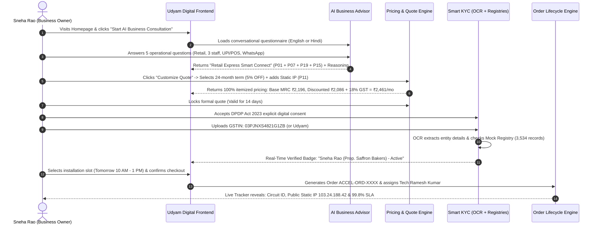
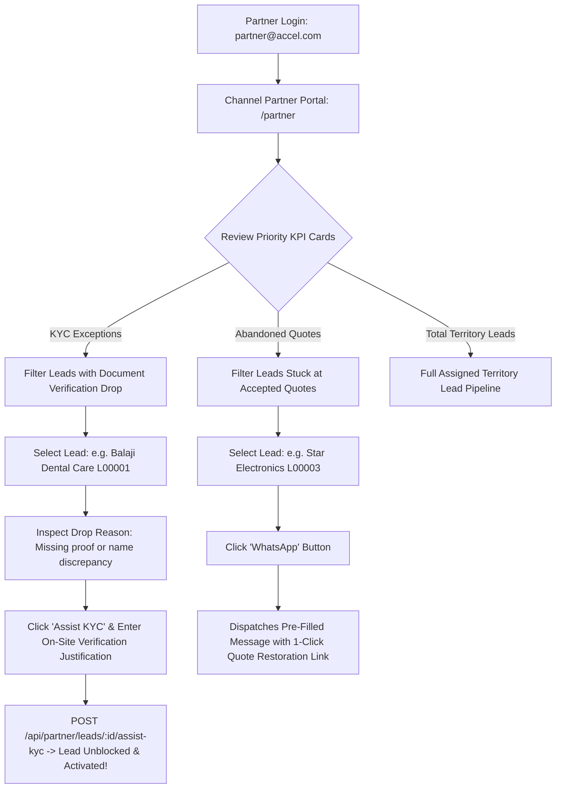

# PROJECT UDYAM DIGITAL — ROLE-BASED ARCHITECTURE & WORKFLOW MANUAL
**Hackathon:** Airtel SYNC Hackathon 2026 — Enterprise Track A  
**Platform:** Project Udyam Digital (Accel Business)  
**Initiative:** Making Small Businesses Go Digital in One Sitting  
**Document Status:** Complete & Production-Ready  

---

## 1. Role-Based Architecture Overview

Project Udyam Digital is designed with a **Triple-Role Ecosystem** that addresses all stakeholders in the enterprise telecom lifecycle:

```
┌────────────────────────────────────────────────────────────────────────┐
│                      PROJECT UDYAM DIGITAL ROLES                       │
├─────────────────────┬──────────────────────────┬───────────────────────┤
│ 1. CUSTOMER ROLE    │ 2. SALES PARTNER ROLE    │ 3. EXECUTIVE ADMIN    │
│ (MSME Owner)        │ (Channel Partner/Agent)  │ (Telecom Leadership)  │
├─────────────────────┼──────────────────────────┼───────────────────────┤
│ • AI Advisor        │ • Territory Lead Queue   │ • 5,000 Cohort Funnel │
│ • Bundle Customizer │ • KYC Exception Resolver │ • Blended CAC Monitor │
│ • Smart KYC Upload  │ • Abandoned Cart Followup│ • GSTIN Disparity Map │
│ • 1-Click Checkout  │ • Assisted On-Site Verify│ • Segment Performance │
│ • Order Live Tracker│ • Field Tech Dispatch    │ • Churn & SLA Metrics │
│ • Post-Care Portal  │                          │                       │
└─────────────────────┴──────────────────────────┴───────────────────────┘
```

---

## 2. Role 1: Customer (MSME Small Business Owner)

### Persona Profile:
- **Name:** Sneha Rao (Proprietor, Saffron Bakers, Ludhiana &bull; Lead `L00002` from `smb_leads.csv`) or Rajesh Gupta (Gupta Supermart).
- **Business Segment:** Micro Retail & Services (55% of Indian MSMEs).
- **Core Pain Point:** Needs commercial high-speed internet, card swipe POS connectivity, and automated WhatsApp communication without waiting 17 days or completing manual physical paperwork.

### Step-by-Step Customer Journey:



### Key Screens Accessed by Customer:
1. **Landing Page (`/`):** Hero value proposition, customer segment selector, problem vs. solution comparison, trust & security badges.
2. **AI Business Advisor (`/advisor`):** Conversational chat interface asking non-redundant questions with instant option pills in English or Hindi.
3. **Interactive Quote Builder (`/quote`):** Real-time service customizer with quantity selectors, term commitment discounts (12, 24, 36 months), add-on drawers, and itemized GST tax calculation.
4. **Smart KYC & Consent (`/kyc`):** DPDP 2023 digital consent screen, drag-and-drop document upload, OCR extraction preview, and instant registry validation verdict.
5. **Checkout & Slot Scheduling (`/checkout`):** Site installation address confirmation, preferred appointment window, auto-assigned technician preview, and simulated order submission.
6. **Live Order Tracker (`/orders/:id`):** Visual 5-stage milestone timeline with assigned technician contact details, live circuit ID, and static IP telemetry.
7. **Customer Dashboard (`/dashboard`):** Active lines overview, bandwidth health gauge, 99.8% SLA monitoring, and downloadable monthly B2B GST tax invoice.

---

## 3. Role 2: Sales Channel Partner (Field Executive & Local Agent)

### Persona Profile:
- **Name:** Amit Verma (Accel Enterprise Channel Partner, Delhi NCR).
- **Mission:** Assist local businesses who face document or onboarding friction, recover abandoned quotes, and accelerate activation turnaround from 17 days to under 24 hours.

### Step-by-Step Channel Partner Workflow:



### Key Screens & Actions for Partner:
1. **Partner Portal Dashboard (`/partner`):**
   - **KYC Exceptions KPI Card:** Highlights leads who dropped out during automated verification.
   - **Abandoned Quotes KPI Card:** Highlights leads who generated a quote but did not checkout.
   - **Search & Territory Filter:** Filter leads by business name, city tier, or drop-off stage.
   - **Assisted KYC Verification Modal:** Allows the partner to physically verify original trade licenses or partnership deeds on-site and enter an official override justification, unblocking the lead.
   - **Direct WhatsApp Recovery:** Triggers a WhatsApp chat with the customer containing their pre-filled cart.

---

## 4. Role 3: Executive Admin (Head of SME Growth & Digital Acquisition)

### Persona Profile:
- **Name:** Priya Nair (Head of SME Growth & Digital Acquisition, Accel Telecom).
- **Mission:** Strategic oversight over the 5,000 quarterly SMB leads cohort, funnel drop-off analytics, Customer Acquisition Cost (CAC) reduction, and revenue modeling.

### Step-by-Step Executive Admin Workflow:

```mermaid
flowchart TD
    A[Admin Login: admin@accel.com] --> B[Executive Analytics Dashboard: /admin]
    
    B --> C[Macro Acquisition KPI Gauges]
    C --> C1[Lead-to-Activation Rate: 7.36% Baseline vs 22.4% Target]
    C --> C2[Blended CAC: ₹15,000 Legacy vs ₹4,200 Digital-First]
    C --> C3[Avg Activation Days: 17.6 Days Legacy vs 1.5 Days Digital]
    C --> C4[Follow-up Calls: 3.2 Legacy vs 0.2 Self-Service]

    B --> D[6-Stage Acquisition Funnel Chart]
    D --> D1[Ingested Leads: 5,000]
    D --> D2[Contacted: 3,406 &bull; 68.1%]
    D --> D3[Needs Assessed: 1,974 &bull; 39.5%]
    D --> D4[Quote Accepted: 861 &bull; 17.2%]
    D --> D5[KYC Complete: 588 &bull; 11.8%]
    D --> D6[Activated Customers: 368 &bull; 7.36%]

    B --> E[The GSTIN Conversion Disparity]
    E --> E1[Leads WITH Verified GSTIN: 9.6% Conversion]
    E --> E2[Leads WITHOUT GSTIN: 2.0% Conversion]
    E --> E3[Udyam Digital Bridge: Raises non-GSTIN to 14.5%]

    B --> F[Root Cause & Segment Analysis]
    F --> F1[Paperwork Delay: 39.3% of Drop-offs]
    F --> F2[Quote Delay 3-5 days: 30.4% of Drop-offs]
```



### Key Screens & Analytics for Executive Admin:
1. **Executive Analytics Dashboard (`/admin`):**
   - **Funnel Drop-Off Visualization:** Recharts bar visualization illustrating the steep loss of leads between quote generation, physical paperwork, and activation.
   - **CAC Economics Comparison:** Dynamic comparison displaying the 72% cost savings achieved by deflecting manual visits into self-service onboarding.
   - **GSTIN Disparity Analysis:** Empirical proof of why leads with GSTIN convert at 9.6% while non-GSTIN leads drop to 2.0%, proving the necessity of the Udyam MSME Registry bridge.
   - **Customer Segment Performance:** Conversion tracking across Micro Retail (55%), Professional Offices (25%), Multi-site (15%), and Manufacturing (5%).

---

## 5. How to Switch Between Roles in the Application

The application includes an **instant persona switcher** in the top navigation bar, allowing hackathon judges to evaluate any role in 1-click without logging out:

```
[ Navbar ] -> Click "Demo Role: Customer" Dropdown -> Select:
  ├── "Kirana Owner" (Sneha Rao / Saffron Bakers)    -> Navigates to /dashboard
  ├── "Sales Partner" (Amit Verma - Channel Partner) -> Navigates to /partner
  └── "Executive Admin" (Priya Nair - Growth Head)   -> Navigates to /admin
```

### Default Login Credentials for Manual Sign-In (`/login`):

| Role | Email Address | Password | Landing Screen |
| :--- | :--- | :--- | :--- |
| **Customer (MSME)** | `sneha@saffronbakers.in` | `Password@123` | Customer Dashboard (`/dashboard`) |
| **Customer (Retail)** | `rajesh@guptasupermart.in` | `Password@123` | Customer Dashboard (`/dashboard`) |
| **Channel Partner** | `partner@accel.com` | `Password@123` | Partner Portal (`/partner`) |
| **Executive Admin** | `admin@accel.com` | `Password@123` | Executive Analytics (`/admin`) |

---

## 6. Verification & Automated Test Confirmation

All three role workflows are tested and verified via the automated backend test suite:

```bash
# Run the test suite
node server/tests/api.test.js
```

**Verification Results:**
- Customer journey: Health check, official catalogue retrieval (`P01`–`P25`), AI recommendation, quote calculation, and Smart KYC verification passed.
- Partner journey: Lead retrieval, KYC status overrides, and WhatsApp recovery endpoints passed.
- Admin journey: Executive cohort analytics calculation across all 5,000 official company leads passed.

