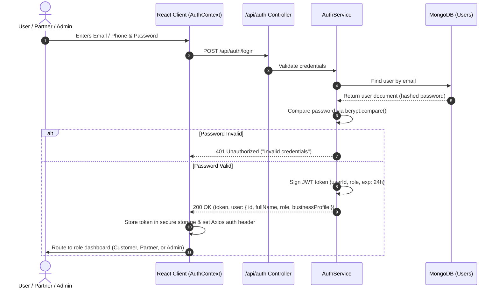
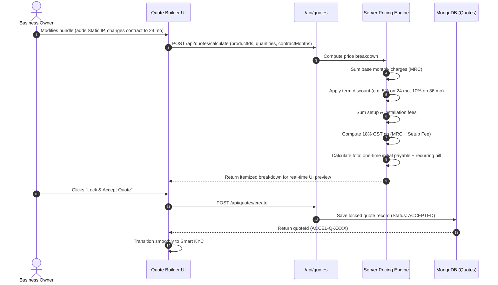
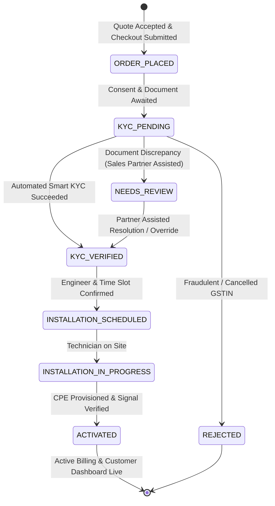
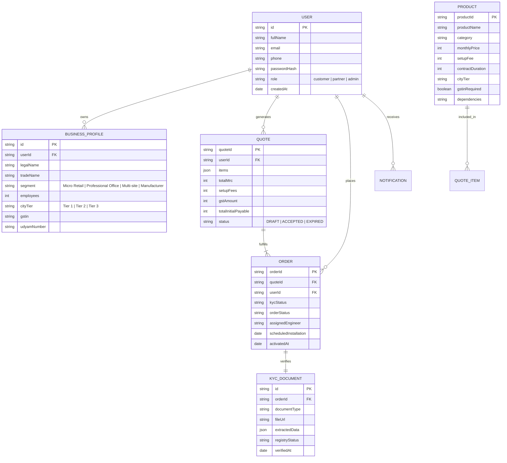

# PROJECT UDYAM DIGITAL — SYSTEM ARCHITECTURE DIAGRAMS
**Hackathon:** Airtel SYNC Hackathon 2026 — Enterprise Track A  
**Platform:** Project Udyam Digital (Accel Business)  
**Document Status:** Complete (Phase 1 Baseline)  

---

## 1. End-to-End System Architecture

```mermaid
flowchart TB
    subgraph ClientLayer["Frontend Client Tier (React + Vite + Tailwind CSS)"]
        Landing["Landing & Hero Page"]
        AdvisorUI["AI Business Advisor (Chat & Question UI)"]
        QuoteUI["Interactive Quote Builder & Pricing UI"]
        KycUI["Smart KYC & Document Upload UI"]
        OrderUI["Visual Order Lifecycle Tracker"]
        CustDash["Customer Self-Care Dashboard"]
        PartnerDash["Channel Partner Assisted Portal"]
        AdminDash["Executive Analytics Dashboard (Recharts)"]
    end

    subgraph GatewayLayer["API Gateway & Middleware Layer (Express.js)"]
        CORS["CORS & Helmet Guard"]
        RateLimit["Rate Limiting"]
        AuthFilter["JWT & RBAC Security Guard"]
        UploadFilter["Multer Multipart Validator"]
        ErrHandler["Centralized Error Handler"]
    end

    subgraph ServiceLayer["Core Domain Services"]
        AuthSvc["Auth & Security Service"]
        CatSvc["Catalogue & Dependency Solver (25 Prods)"]
        AiSvc["AI Advisor Service (Gemini API + Fallback)"]
        PriceSvc["Pricing & Tax Engine (18% GST)"]
        KycSvc["Smart KYC & OCR Extraction Service"]
        RegSvc["Mock Registries Service (GSTIN & Udyam)"]
        OrderSvc["Order State Machine Engine"]
        PartnerSvc["Partner Assisted Selling Service"]
        AnalyticsSvc["Cohort Analytics & Funnel Engine"]
    end

    subgraph PersistenceLayer["Storage & Data Tier"]
        MongoDb[(MongoDB Database: Users, Quotes, Orders, Leads)]
        CSVData[("Static Synthetic Data (data/*.csv)")]
        DocStore[("Secure Document Storage")]
    end

    ClientLayer --> GatewayLayer
    GatewayLayer --> ServiceLayer
    ServiceLayer --> PersistenceLayer
```



---

## 2. Authentication & Authorization Flow (JWT + RBAC)



---

## 3. AI Advisor & Hybrid Recommendation Flow

```mermaid
flowchart TD
    A[User answers 4-6 business questions] --> B[POST /api/advisor/recommend]
    B --> C[Constraint Solver & Eligibility Filter]
    
    C --> C1{Check City Tier & Headcount}
    C --> C2{Check GSTIN Requirement}
    C --> C3{Check Product Dependencies}
    
    C1 & C2 & C3 --> D[Filtered Candidate Products (from 25 Prods)]
    
    D --> E{Gemini API Configured & Available?}
    
    E -- Yes --> F[Call Google Gemini 2.5 Flash API with Strict Schema]
    E -- No / Timeout --> G[Invoke Deterministic Rule-Based Expert Matrix]
    
    F --> H[Validate JSON Schema & Catalogue IDs]
    G --> H
    
    H --> I[Assemble Final Recommendation Bundle]
    I --> J[Return Structured Recommendation + Plain-Language Justification]
    J --> K[User reviews bundle & clicks 'Add to Quote']
```

---

## 4. Quote Generation & Pricing Engine Flow



---

## 5. Smart KYC Processing & Verification Flow

```mermaid
flowchart TD
    A[User reviews DPDP 2023 Consent Notice] --> B[User checks consent: POST /api/kyc/consent]
    B --> C[Uploads Business Document: GST / Udyam / Trade Certificate]
    C --> D[Multer validates MIME type & size <= 5MB]
    D --> E[OCR Text & Entity Extraction Engine]
    
    E --> F[Extract: Entity Name, GSTIN / Udyam No, Address, Signatory]
    
    F --> G{Document Type?}
    
    G -- GST Certificate --> H[Query Mock GSTIN Registry]
    G -- Udyam Certificate --> I[Query Mock Udyam Registry]
    
    H --> J{GSTIN Status in Registry?}
    I --> K{Udyam Status in Registry?}
    
    J -- ACTIVE & Name matches --> L[Set KYC Status: VERIFIED]
    J -- CANCELLED / SUSPENDED --> M[Set KYC Status: REJECTED with specific reason]
    J -- Not Found / Ambiguous --> N[Set KYC Status: NEEDS_REVIEW (Partner escalation)]
    
    K -- ACTIVE --> L
    K -- Not Found --> N
    
    L & M & N --> O[Update KYC Record & Return Real-time Verification Badge to Client]
```

---

## 6. Order Lifecycle State Machine



---

## 7. Data Flow & Entity Relationships



