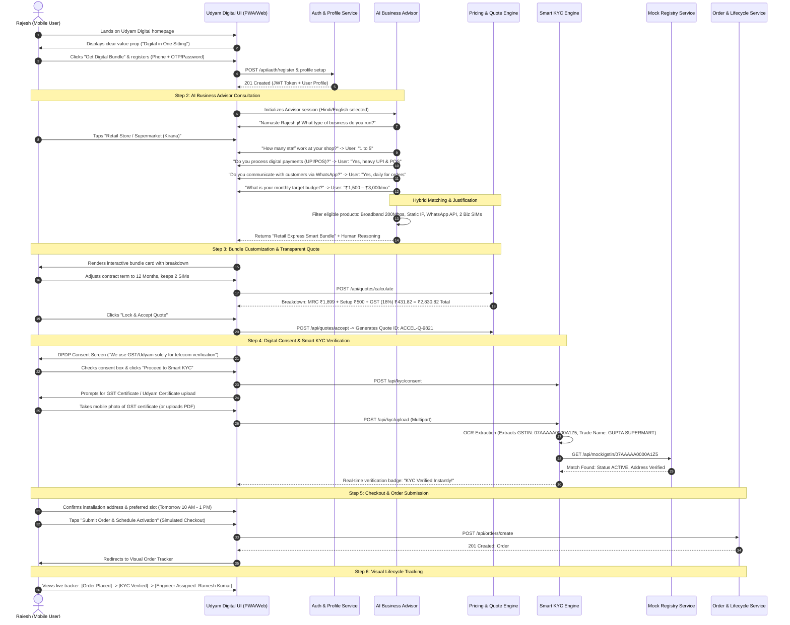
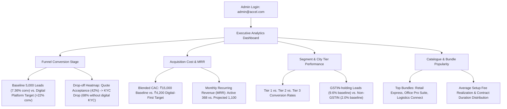
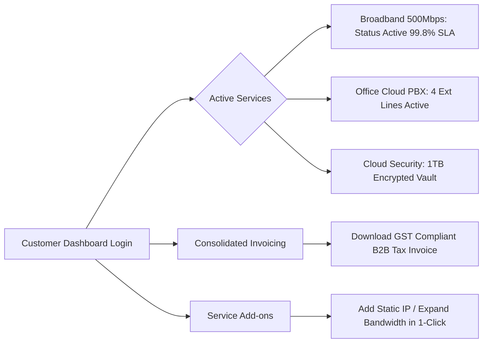

# PROJECT UDYAM DIGITAL — USER JOURNEYS & EXPERIENCE FLOWS
**Hackathon:** Airtel SYNC Hackathon 2026 — Enterprise Track A  
**Platform:** Project Udyam Digital (Accel Business)  
**Document Status:** Complete (Phase 0 Baseline)  

---

## 1. Journey 1: Primary Self-Service Customer Journey (Mobile-First)

### Persona: Rajesh Gupta (Owner of Gupta Supermart, Sector 18, Noida)
**Goal:** Upgrade shop connectivity from unstable consumer Wi-Fi to a dedicated enterprise business bundle with static IP, commercial WhatsApp communication, and POS backup within one 10-minute sitting on his smartphone.



### Edge Cases & Exception Handling in Journey 1:
1. **GSTIN / Udyam Not Available:**
   - *Flow:* If Rajesh has neither GSTIN nor Udyam, the platform does not block him. Instead, it flags the KYC as `NEEDS_REVIEW`, automatically restricts products requiring mandatory GSTIN (such as Leased Line or Multi-SIM Pooling), recommends single-line business broadband with PAN + Shop Electricity Bill, and schedules a priority field verification visit.
2. **OCR Failure / Blurry Image:**
   - *Flow:* If the camera photo is unreadable, the OCR engine alerts: *"Document text is unclear. Please re-upload a sharper image or enter GSTIN manually for instant validation."* Rajesh enters the 15-digit GSTIN manually, and the registry validates it seamlessly.
3. **Budget Exceeded:**
   - *Flow:* If the recommended bundle exceeds the user's selected budget, the advisor highlights an *"Economical Tier"* switch, swapping 500Mbps for 100Mbps and reducing optional static IP to bring the price within target range.

---

## 2. Journey 2: Assisted Channel Partner / Sales Executive Journey

### Persona: Amit Verma (Accel Business Channel Partner, Delhi NCR)
**Goal:** Track local business leads, assist customers who abandoned their quotes or failed document uploads, and accelerate lead-to-activation turnaround from 17 days down to under 24 hours.

```mermaid
sequenceDiagram
    autonumber
    actor Partner as Amit (Channel Partner)
    participant UI as Partner Dashboard UI
    participant LeadService as Lead & Opportunity Service
    participant QuoteService as Quote Service
    participant OrderService as Order Tracking Service

    Partner->>UI: Log in with Partner credentials (partner@accel.com)
    UI->>Partner: Displays Partner Dashboard: 28 Total Assigned Leads, 4 KYC Exceptions, 6 Abandoned Quotes
    Partner->>UI: Filters leads by status: "KYC_FAILED" & "ABANDONED_QUOTE"
    Partner->>UI: Selects Lead "Sharma Chemist & Druggist" (Propensity Score: 88/100)
    UI->>LeadService: GET /api/partner/leads/:id
    LeadService-->>UI: Lead details: Quote generated ₹2,499/mo; Document upload failed (Name mismatch)
    
    Partner->>Partner: Calls customer directly with pre-filled context
    Partner->>UI: Clicks "Assisted Document Resubmission"
    Partner->>UI: Uploads corrected Partnership Deed / Trade License verified on-site
    UI->>LeadService: POST /api/partner/leads/:id/override-kyc
    LeadService-->>UI: Status updated to "KYC_VERIFIED"
    
    Partner->>UI: Assigns Field Engineer & sets installation slot: "Today 4:00 PM"
    UI->>OrderService: PATCH /api/orders/:id/schedule
    OrderService-->>UI: Installation Scheduled. SMS/In-app notification dispatched to customer.
```

### Key Partner Capabilities:
- **Instant Abandoned Quote Recovery:** View cart items left by MSMEs and trigger a one-click WhatsApp reminder with an instant checkout link.
- **KYC Exception Resolving:** Upload verified secondary proofs when automated OCR flags small typographical discrepancies between trade name and PAN card.
- **Field Engineer Dispatch:** Real-time visibility into local technician queues to schedule fiber pulls and CPE router deliveries within 24 hours.

---

## 3. Journey 3: Executive Admin & Analytics Journey

### Persona: Priya Nair (Head of SME Growth & Digital Acquisition, Accel Telecom)
**Goal:** Monitor macro conversion performance across the 5,000-lead cohort, identify acquisition friction points, track Customer Acquisition Cost (CAC), and assess bundle profitability.



---

## 4. Journey 4: Post-Activation Customer Self-Care Journey

### Persona: Adv. Sneha Sen Sharma (Post-Activation Legal Office)
**Goal:** Manage active broadband lines, monitor office data quota and Wi-Fi security, review monthly GST tax invoices, and request additional cloud storage in seconds without calling customer support.


